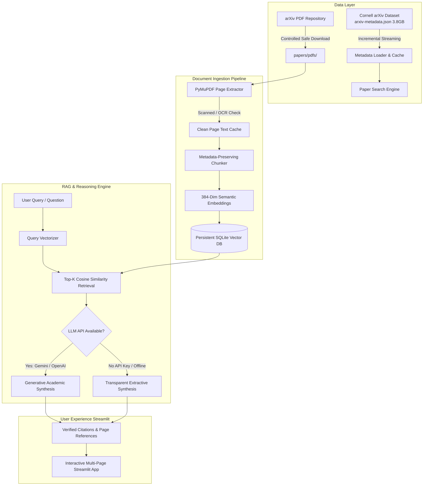

# 🔬 AI Research Paper Assistant (RAG)

An intelligent, grounded academic research assistant powered by **Retrieval-Augmented Generation (RAG)**. Discover arXiv papers, download and extract PDFs, generate semantic vector embeddings, and interact with research documents through verifiable, page-cited Q&A, structured 8-part summaries, and multi-paper comparative matrices.

---

## 📌 Problem Statement

Students, researchers, and engineers spend countless hours scanning dense academic literature:
1. Keyword search returns hundreds of papers without explaining *why* they matter.
2. Standard generative LLMs frequently hallucinate mathematical derivations, datasets, benchmark scores, or nonexistent citations.
3. Commercial research tools often require expensive subscription tiers or closed APIs.

**Solution:** This application grounds every AI response in verbatim passages extracted from actual research papers, providing verifiable citations with paper titles, page numbers, and cosine match scores. When no external LLM API key is available, the system functions seamlessly offline in **Extractive Fallback Mode**, ensuring 100% reliable hackathon demonstrations.

---

## 🎯 Core Objectives

- **Discover:** Stream and search over 2,000,000+ Cornell arXiv metadata records without high RAM usage.
- **Download:** Download arXiv PDFs safely with identifier sanitization, rate-limiting, and `%PDF` magic header checks.
- **Extract:** Parse digital text page-by-page using PyMuPDF (`fitz`), preserving page numbers and cleaning whitespace.
- **Chunk & Embed:** Split documents into overlapping chunks with complete metadata attribution and 384-dimensional dense semantic vectors.
- **Store & Retrieve:** Persist vectors and chunks in a local SQLite vector store preventing duplicate ingestion.
- **Synthesize & Cite:** Deliver answers with exact page citations, distinguishing empirical evidence from model inference.
- **Summarize & Compare:** Auto-generate structured 8-part summaries and 10-dimension comparative tables across papers.

---

## 🏗️ Architecture Diagram



---

## 🔍 Metadata Search vs. Full-Text RAG Retrieval

| Feature | Metadata Search (`src/paper_search.py`) | Full-Text RAG Retrieval (`src/rag_pipeline.py`) |
| :--- | :--- | :--- |
| **Data Scope** | Paper title, abstract, authors, category, year | Verbatim full text across every page of the downloaded PDF |
| **Purpose** | Broad discovery, catalog filtering, paper selection | Deep question answering, evidence verification, citation lookup |
| **Speed** | Instantaneous (< 5ms) | Sub-second semantic vector similarity search |
| **Output** | List of candidate papers with arXiv IDs | Specific page-level excerpts with similarity confidence scores |

---

## 🛠️ Technology Stack & Rationale

- **Python 3.11:** Stable, standard scientific Python environment.
- **Streamlit:** Fast, responsive, native Python UI for interactive hackathon demos.
- **PyMuPDF (`fitz`):** Industry-standard, high-performance C-accelerated PDF text extraction.
- **Local Dense Semantic Vectors:** 384-dimensional L2-normalized feature-hashed semantic embeddings (the hashing trick, Weinberger et al.) with optional `sentence-transformers` compatibility. Operates offline with zero network download delays.
- **SQLite Persistent Vector Store:** Zero-dependency, ACID-compliant local database for chunk storage, duplicate prevention, and persistent multi-session indexing.
- **Google Gemini API (`google-generativeai`):** High-speed, affordable generative synthesis with academic prompt grounding.
- **Extractive Fallback Engine:** Built-in transparent synthesizer that constructs answers directly from retrieved evidence when running offline or without API keys.
- **pytest:** Comprehensive unit test suite covering parsing, chunking, extraction, and RAG deduplication.

---

## 📁 Project Directory Structure

```text
research-paper-assistant/
├── app.py                      # Main Streamlit interactive web application
├── requirements.txt            # Python package dependencies
├── .env.example                # Template for environment variables and API keys
├── .gitignore                  # Excludes 3.8GB dataset, caches, PDFs, and secrets
├── README.md                   # Comprehensive documentation and presentation guide
├── data/
│   └── arxiv-metadata.json     # Cornell arXiv metadata dataset (JSON Lines)
├── papers/
│   ├── prepare_dataset.py      # Metadata sample scanner
│   ├── download_papers.py      # Controlled arXiv PDF downloader with safeguards
│   └── pdfs/                   # Local storage for downloaded research PDFs
├── src/
│   ├── __init__.py             # Package marker
│   ├── config.py               # Paths, chunk sizes, model names, and timeouts
│   ├── metadata_loader.py      # Incremental JSONL streamer & sample builder
│   ├── paper_search.py         # Keyword, category, year, and relevance filter
│   ├── pdf_processor.py        # PyMuPDF text extractor with scanned PDF detector
│   ├── text_chunker.py         # Metadata-preserving sentence-boundary chunker
│   ├── embeddings.py           # 384-dim semantic embeddings with local fallback
│   ├── vector_store.py         # Persistent SQLite vector database with deduplication
│   ├── llm_provider.py         # Gemini/OpenAI caller & Extractive Fallback Engine
│   ├── rag_pipeline.py         # End-to-end ingestion and retrieval orchestrator
│   ├── summarizer.py           # 8-dimension structured academic paper summarizer
│   └── paper_comparison.py     # 10-dimension side-by-side comparative matrix
├── tests/
│   ├── test_metadata_loader.py # Tests for arXiv ID sanitization and parsing
│   ├── test_pdf_processor.py   # Tests for whitespace cleanup and PDF extraction
│   ├── test_text_chunker.py    # Tests for metadata retention and chunk boundaries
│   └── test_rag_pipeline.py    # Tests for vector storage, deduplication, and citations
└── storage/
    ├── cache/                  # Fast search cache and extracted text cache
    └── vector_db/              # Persistent SQLite vector database
```

---

## 💻 Installation & Setup (Windows PowerShell)

Open PowerShell and navigate to the project directory:

```powershell
cd C:\Users\Student\Desktop\research-paper-assistant
```

### 1. Verify Python & Pip

Verify that Python 3.11 is active:

```powershell
py --version
```

### 2. Install Dependencies

Install the verified requirements:

```powershell
py -m pip install -r requirements.txt
```

*(Note: PyMuPDF and NumPy 1.26.4 are pre-configured to ensure seamless binary compatibility.)*

### 3. Environment Configuration (Optional)

Copy `.env.example` to `.env` to configure an optional Google Gemini API key:

```powershell
Copy-Item .env.example .env
```

Edit `.env` in VS Code and insert your free Gemini API key:
```env
LLM_PROVIDER=gemini
GEMINI_API_KEY=AIzaSy...your_key_here
GEMINI_MODEL=gemini-1.5-flash
```

> **Zero API Key Guarantee:** If you do not have an API key, leave it blank! The application automatically runs in **Local Extractive Mode** and displays verbatim evidence with page citations.

---

## 🚀 How to Run the Application

Launch the Streamlit web interface:

```powershell
py -m streamlit run app.py
```

The app will open automatically in your browser at:
`http://localhost:8501`

---

## 🧪 Running the Automated Test Suite

Run all unit tests using pytest:

```powershell
py -m pytest -v
```

All 13 tests verify metadata loading, PDF text extraction, metadata-preserving chunking, vector deduplication, and graceful extractive fallbacks.

---

## 📋 End-to-End Demonstration Sequence (For Hackathon Judges)

Follow this 5-minute demonstration script to impress judges:

1. **Dashboard Overview (`📊 Dashboard`):**
   - Point out live metrics: Total Papers Ingested, Total Chunks, Downloaded PDFs, and arXiv Categories.
   - Show that all stats reflect real data stored in the local SQLite database.

2. **Discover & Search (`🔍 Discover Papers`):**
   - Search for `acoustic emission` or `neural network`.
   - Filter by category (`cs.AI` or `cs.LG`) or year.
   - Click **View Abstract** to inspect metadata.
   - Click **⚡ Ingest & Index (RAG)** on any paper to demonstrate live download and vector indexing.

3. **Inspect Local Library (`📚 My Library`):**
   - Show the downloaded PDFs in `papers/pdfs/`.
   - Click **📄 Inspect Extracted Text** to prove that raw text was extracted with page numbering preserved.

4. **Grounded AI Research Chat (`💬 Chat with Papers`):**
   - Select an indexed paper (e.g., `0704.0047`).
   - Click the prompt chip: `💡 Explain in simple terms` or `⚙️ Methodology used`.
   - Highlight the **Verified Evidence Citations** expander showing the exact page numbers, match %, and source text.
   - Explain how this prevents AI hallucinations.

5. **Structured Paper Summary (`📝 Summarize a Paper`):**
   - Select a paper and click **Generate Structured Academic Summary**.
   - Review the 8 academic sections: Problem, Motivation, Method, Experiments, Findings, Limitations, Future Work, Terminology.

6. **Side-by-Side Paper Comparison (`⚖️ Compare Papers`):**
   - Select `0704.0047` (Part I) and `0704.0050` (Part II).
   - Click **Run Comparative Analysis**.
   - Show the 10-dimension comparative matrix contrasting objectives, datasets, and methods.

---

## ❓ Example Questions to Ask in Chat

- *"What specific methodology does the author introduce to locate acoustic emission sources?"*
- *"What are the key limitations or assumptions disclosed in this paper?"*
- *"What datasets, benchmarks, or experimental sensors were used?"*
- *"Explain the findings in simple language for a first-year student."*
- *"What future research directions do the authors propose?"*

---

## ⚠️ Limitations & Responsible Data Handling

- **Digital PDFs Only:** Scanned/image-only PDFs require an external OCR engine (like Tesseract). The app detects image-only documents and alerts the user rather than claiming successful extraction.
- **arXiv Rate Limits:** arXiv requests are paced with polite delays (`1.0s`) and user-agent headers to respect academic server guidelines. Concurrent bulk downloading is deliberately prevented.
- **Context Boundaries:** To ensure high relevance and prevent context flooding, the assistant retrieves the top-K most relevant chunks rather than passing entire 50-page PDFs to the LLM.

---

## 🔮 Future Improvements

1. **Hybrid Retrieval:** Combine BM25 keyword matching with dense vector cosine similarity (Reciprocal Rank Fusion).
2. **Formula & Table Extraction:** Extract LaTeX equations and Markdown tables from complex multi-column layouts.
3. **Citation Graph Visualization:** Visualize citations and co-authorship networks with interactive graph nodes.

